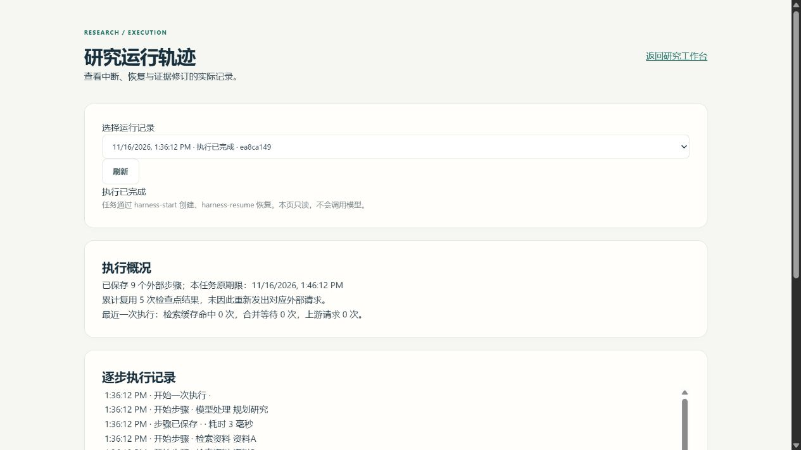

# DeepResearch Agent

面向技术调研的 Python Agent。它将问题拆成研究要点，从资料中选取证据，生成带引用的简报，并记录审查意见与未解决缺口。本地工作台可以查看报告和运行轨迹。

- **研究流程**：DAG 调度、受限并发、来源快照、证据选段与 Red–Blue 审查。
- **运行控制**：SQLite 检查点、执行租约、预算与期限继承。同一任务的已完成外部动作在恢复时可复用。
- **证据与资源**：原文偏移与内容校验、按要点分配上下文、TTL/LRU 检索缓存、同实例请求合并。

## 快速体验

需要 Python 3.12 和 uv。首次安装依赖需要网络，以下演示使用内置资料与固定响应，无需 API 密钥。

```bash
uv sync --locked
uv run --locked python scripts/public_demo.py
uv run --locked research serve --port 8768 --db "<RUN_DIR>/web.sqlite3" --output-dir "<RUN_DIR>/reports"
```

把 `<RUN_DIR>` 替换成演示输出中的 `output_dir`，路径含空格时请加引号。打开 [本地工作台](http://127.0.0.1:8768/) 体验网页演示。打开 [运行轨迹](http://127.0.0.1:8768/harness) 查看命令行演示生成的任务，展开研究要点可核对引文和缺口。服务默认绑定回环地址。

[演示步骤](docs/demo.md)包含断点恢复、产物位置和预期结果。这里有一份[离线示例报告](examples/demo-report.md)。



## 评测

[评测报告](docs/evaluation.md)列出数据口径、结果和失败案例。[公开结果数据](examples/evaluation-metrics.json)仅包含可公开的汇总与逐题指标。

```bash
uv run --locked research bench-run --presets baseline full --limit 3 --seed 42
uv run --locked python scripts/benchmark_research_harness.py
uv run --locked pytest -q
```

第一条运行内置合成题库。输出中的 results.json 路径可用于 `research bench-compare`。第二条用子进程故障注入检查恢复和请求合并，等待租约自然到期约需 30 秒。历史有源文档实验在报告中提供汇总，精确复跑需要其原始资料和模型响应。

## 真实研究

复制 `.env.example` 为 `.env`，自行配置 DeepSeek API 密钥。运行下面的命令会请求模型和 Wikipedia，可能产生费用。模型步数上限针对该任务。公开版断点恢复入口使用离线演示资料。

```bash
uv run --locked research run-dag "SQLite 的 WAL 模式为何仍会出现写争用？" --max-model-calls 3
```

参考[架构与边界](docs/architecture.md)。提交缺陷时请使用合成问题和资料，避免附上密钥、私有原文和原始模型响应。

## 许可证

[MIT](LICENSE)
